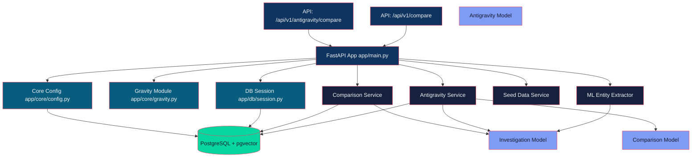
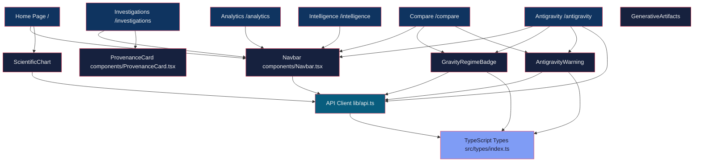
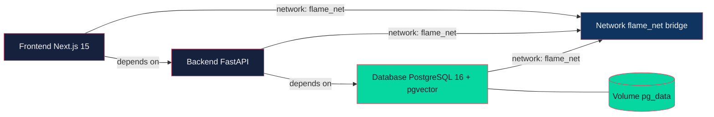
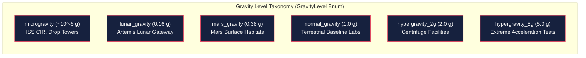

# NASA SPACE APP 2026 - System Architecture & Pipeline Flow Diagrams

This document contains Mermaid diagrams capturing the project task workflows, architecture components, and scientific pipelines for **Flame in Freefall**.

For the detailed pipeline specifications, refer to [PIPELINE_FLOW_DIAGRAMS.md](docs/PIPELINE_FLOW_DIAGRAMS.md).

---

## Diagram 1: Complete Project Task Workflow

```mermaid
graph TD
    classDef agent fill:#e94560,color:#f1f1f1,stroke:#f1f1f1,stroke-width:2;
    classDef phase fill:#16213e,color:#f1f1f1,stroke:#e94560;
    
    P1[Phase 1: Backend Foundation]:::phase
    P1 --> T1[Create backend/app/core/gravity.py]
    P1 --> T2[Update schemas/compare.py]
    P1 --> T3[Update ml/entity_extractor.py]
    
    P2[Phase 2: Services]:::phase
    P2 --> T4[Update investigation_service.py]
    P2 --> T5[Update comparison_service.py]
    P2 --> T6[Create antigravity_service.py]
    
    P3[Phase 3: API]:::phase
    P3 --> T7[Create endpoints/antigravity.py]
    P3 --> T8[Update router.py]
    
    P4[Phase 4: Data & Seed]:::phase
    P4 --> T9[Update seed_data.py]
    P4 --> T10[Update PROJECT.md]
    
    P5[Phase 5: Frontend]:::phase
    P5 --> T11[Update types/index.ts]
    P5 --> T12[Update lib/api.ts]
    P5 --> T13[Create GravityRegimeBadge.tsx]
    P5 --> T14[Create AntigravityWarning.tsx]
    P5 --> T15[Create antigravity/page.tsx]
    P5 --> T16[Update Navbar.tsx]
    P5 --> T17[Update investigations/page.tsx]
    P5 --> T18[Update compare/page.tsx]
    
    P6[Phase 6: Testing]:::phase
    P6 --> T19[Run frontend build]
    P6 --> T20[Create backend/tests/test_antigravity.py]
    P6 --> T21[Create tests/e2e/test_tier1_antigravity.py]
    P6 --> T22[Create tests/e2e/test_tier4_antigravity_journey.py]
    P6 --> T23[Update conftest.py]
    P6 --> T24[Update test_tier3_cross_feature.py]
    
    P7[Phase 7: Finalization]:::phase
    P7 --> T25[Run full test suite]
    P7 --> T26[Update README.md]
    P7 --> T27[Commit all changes]
```

---

## Diagram 2: Backend Architecture

---

## Diagram 3: Frontend Architecture

---

## Diagram 4: Docker & Deployment Architecture

---

## Diagram 5: Gravity Level Classification Taxonomy

