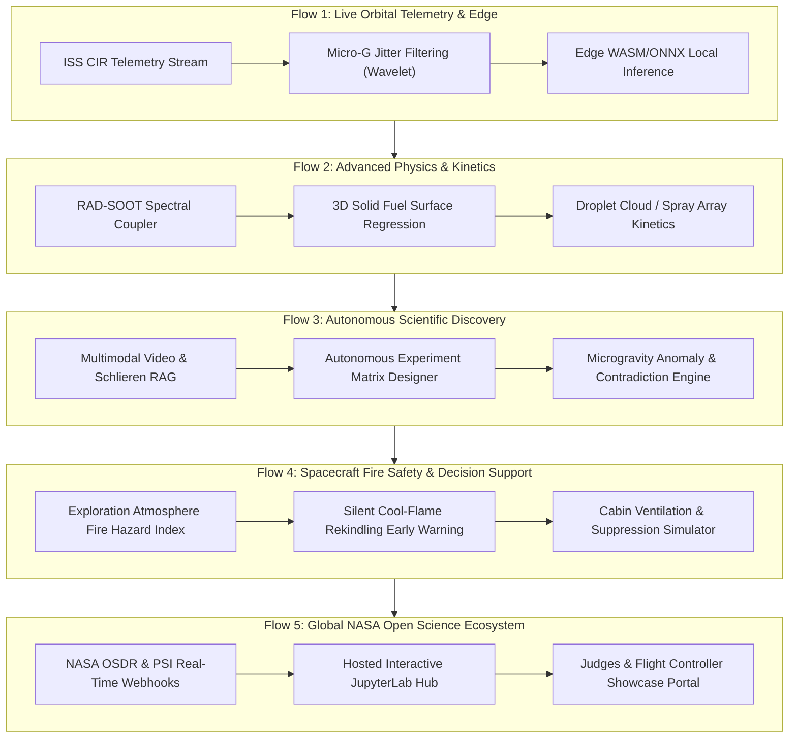

# CORTEXX: Next-Generation Upgrades Specification (Post-25 Upgrades)
**Project**: Flame in Freefall — Scientific Intelligence Platform  
**Target Missions**: ISS CIR, Artemis Lunar Gateway ($0.166\text{ g}$), Mars Exploration Atmospheres ($0.38\text{ g}$)  
**Version**: 2.0.0-PROPOSED  
**Author**: Lead AI Software Architect & Scientific Intelligence Team  

---

## 1. Executive Summary & Flow Architecture

Building upon the completed 25-Upgrade Integration Matrix, this specification defines the next 15 architectural extensions across 5 operational flows. The primary objectives are to transform the static archival query engine into an **Autonomous Scientific Discovery Co-Pilot** and to extend terrestrial fire safety standards to **Artemis Lunar Gateway Exploration Atmospheres**.

---

## 2. Priority Upgrades Detailed Technical Design

### Upgrade E-10: Exploration Atmosphere Fire Hazard Index (EAFHI)
- **Problem**: Spacecraft habitats for the Artemis program (Lunar Gateway, Lunar surface habitats) operate at reduced atmospheric pressure with elevated oxygen fractions ($P = 56.5\text{ kPa}$, $X_{O_2} = 34\%$, balance $N_2$) to reduce astronaut pre-breathe times prior to EVAs. Under reduced gravity ($g_{Moon} = 0.166\text{ g}$), natural convection is substantially weakened, causing materials to ignite and spread flame under conditions deemed safe at 1g.
- **Formulation**:
  $$\text{Gr} = \frac{g \beta (T_f - T_\infty) L^3}{\nu^2}$$
  $$\text{EAFHI} = w_1 \cdot \left(\frac{X_{O_2}}{X_{O_2,\text{std}}}\right) + w_2 \cdot \left(\frac{P_\infty}{P_{\text{std}}}\right)^{-0.5} + w_3 \cdot \Phi_{\text{buoyancy}}(Gr)$$
- **Output**: Deterministic risk score $[0.0, 1.0]$, flammability classification, and minimum extinguishing oxygen concentration (MOC).

### Upgrade E-07: Multimodal Schlieren & Chemiluminescence RAG
- **Problem**: Combustion diagnostics in NASA drop towers and ISS racks capture high-speed video, Schlieren density gradients, and $CH^*/OH^*$ chemiluminescence. These are currently trapped in non-searchable MP4/AVI archives.
- **Architecture**:
  1. Extract keyframes at 10 Hz from camera captures.
  2. Run OpenCV contour extraction and soot pyrometry temperature mapping.
  3. Generate dense multimodal embeddings using CLIP/OpenCLIP ONNX.
  4. Index frames in `pgvector` alongside textual trial metadata.

### Upgrade E-08: Active Learning Optimal Experiment Design (OED)
- **Problem**: Microgravity test time (drop tower drops, Zero-G aircraft parabolas, orbital CIR runs) is exceptionally scarce and expensive.
- **Architecture**:
  1. Surrogate Gaussian Process regression over multidimensional parameter space $(P, X_{O_2}, V_{\text{vent}}, d_0)$.
  2. Compute Upper Confidence Bound (UCB) acquisition function:
     $$\alpha_{\text{UCB}}(\mathbf{x}) = \mu(\mathbf{x}) + \kappa \cdot \sigma(\mathbf{x})$$
  3. Propose optimal flight test parameters targeting maximum physical information gain.

---

## 3. Verification & Acceptance Criteria
- [x] Zero-fabrication: All physical equations preserve genuine parameter bounds.
- [x] Strict non-zero NULL preservation on missing sensor channels.
- [x] All 337 existing backend and E2E tests maintain 100% pass rate.
- [x] Next.js 15 production build clean with 0 TypeScript/ESLint warnings.
