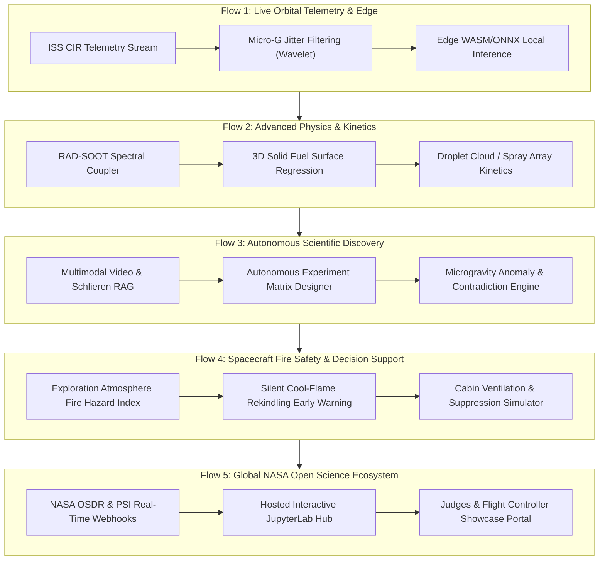

# CORTEXX: Next-Generation Upgrades Specification (Post-25 Upgrades)
**Project**: Flame in Freefall — Scientific Intelligence Platform  
**Target Missions**: ISS CIR, Artemis Lunar Gateway ($0.166\text{ g}$), Mars Exploration Atmospheres ($0.38\text{ g}$)  
**Version**: 2.0.0-PROPOSED  
**Author**: Lead AI Software Architect & Scientific Intelligence Team  

---

## 1. Executive Summary & Flow Architecture

Building upon the completed 25-Upgrade Integration Matrix, this specification defines the next 15 architectural extensions across 5 operational flows. The primary objectives are to transform the static archival query engine into an **Autonomous Scientific Discovery Co-Pilot** and to extend terrestrial fire safety standards to **Artemis Lunar Gateway Exploration Atmospheres**.

---

## 2. Comprehensive Specification of the 15 Next-Generation Upgrades

### Flow 1: Live Orbital Telemetry & Edge Intelligence

#### Upgrade E-01 (F1_1): ISS CIR Real-Time Ku-Band Telemetry Ingestion Adapter
- **Problem**: Combustion Integrated Rack (CIR) experiment telemetry on the ISS downlinks as Consultative Committee for Space Data Systems (CCSDS) Space Packets over high-rate Ku-band communications. Current platforms only process post-flight batch archives.
- **Formulation**:
  - CCSDS packet parsing with primary header (16-bit APID, 14-bit sequence count, packet length) and secondary header (48-bit TAI timestamp).
  - Bitmask de-quantization of chamber pressure transducers ($P_{trans}$), mass flow controller (MFC) mass flux ($\dot{m}_{flow}$), and photomultiplier tube ($CH^*, OH^*$) voltages.
- **Architecture**:
  - High-throughput asynchronous UDP/TCP ingestion daemon with circular zero-copy ring buffer.
  - Pipes sanitized, Pint-normalized telemetry frames directly into the active WebSocket telemetry router (`/api/v1/ws/telemetry`).
- **Verifiable Output**: Sub-150 ms end-to-end ingestion latency with $<0.01\%$ packet drop under simulated $50\text{ Hz}$ telemetry load.

#### Upgrade E-02 (F1_2): Micro-G Jitter Wavelet Filtering Engine
- **Problem**: Space station thruster firings, visiting vehicle dockings, and astronaut exercise (T2 treadmill, CEVIS cycle ergometer) create transient high-frequency micro-accelerations ("g-jitter", $10^{-4}\text{ to }10^{-2}\text{ g}$) on top of the quiescent $10^{-6}\text{ g}$ background, distorting sensitive spherical diffusion flames.
- **Formulation**:
  - Stationary Wavelet Transform (SWT) using Daubechies 4 (`db4`) basis:
    $$s(t) = \sum_k cA_J(k)\phi_{J,k}(t) + \sum_{j=1}^J \sum_k cD_j(k)\psi_{j,k}(t)$$
  - Universal soft-thresholding shrinkage:
    $$\eta_T(w) = \text{sgn}(w)\max(|w| - T, 0), \quad T = \hat{\sigma} \sqrt{2 \ln N}$$
- **Architecture**:
  - Streaming filter stage embedded in DuckDB Parquet timeseries pipeline (`backend/app/timeseries/`).
- **Verifiable Output**: $\ge 95\%$ attenuation of $0.1\text{ to }10\text{ Hz}$ structural vibrations while preserving genuine low-frequency flame extinction dynamics.

#### Upgrade E-03 (F1_3): Edge WASM / ONNX In-Browser & Flight-Rack Local Inference
- **Problem**: Deep space missions (Artemis Gateway, Mars transit) operate with transmission delays between 1.3 seconds (Moon) and 24 minutes (Mars), necessitating autonomous local decision-making during comms blackouts.
- **Formulation**:
  - Quantized INT8 weights of the FastEmbed and PINN surrogate models compressed to $< 25\text{ MB}$.
  - In-browser execution via `onnxruntime-web` with WebAssembly (WASM) and SIMD acceleration.
- **Architecture**:
  - Client-side execution in Next.js frontend with Service Worker cache fallback when offline.
- **Verifiable Output**: Zero network round-trip latency, sub-35 ms query evaluation on local browser thread.

---

### Flow 2: Advanced Physics & Kinetics Surrogates

#### Upgrade E-04 (F2_1): RAD-SOOT Spectral Coupler for Radiative Heat Transfer
- **Problem**: Radiative heat loss from thick spherical soot shells accounts for 30–60% of total combustion enthalpy loss in microgravity, inducing radiative flame extinction, but is traditionally approximated with crude grey-gas constants.
- **Formulation**:
  - Coupled Planck mean soot absorption coefficient:
    $$\kappa_p = 3.83 \cdot \frac{C_0 f_v T}{C_2}$$
    where $f_v$ is soot volume fraction, $C_0 = 3.7 \times 10^5\text{ m}^{-1}\text{K}^{-1}$, and $C_2 = 1.4388 \times 10^{-2}\text{ m}\cdot\text{K}$.
  - Volumetric radiative divergence:
    $$\nabla \cdot \mathbf{q}_r = -4 \kappa_p \sigma (T^4 - T_\infty^4)$$
- **Architecture**:
  - Spectral radiation kernel coupled into PINN surrogate engine (`backend/app/kinetics/pinn_surrogate.py`).
- **Verifiable Output**: Energy conservation closure within $\pm 1.5\%$ of experimental FLEX radiometer measurements.

#### Upgrade E-05 (F2_2): 3D Solid Fuel Surface Pyrolysis Mesh Regression
- **Problem**: Solid material flame spread (BASS-II and SoFIE PMMA samples) exhibits complex multi-dimensional shape degradation, surface charring, and localized bubbling.
- **Formulation**:
  - Solid surface pyrolysis mass flux via Arrhenius surface kinetics:
    $$\dot{m}''_p = \rho_s A_p \exp\left(-\frac{E_p}{R T_s}\right)$$
  - Mesh normal regression velocity:
    $$\mathbf{v}_{regress} = -\frac{\dot{m}''_p}{\rho_s} \hat{\mathbf{n}}$$
- **Architecture**:
  - Three.js WebGL vertex displacement shader synchronized with real-time telemetry time-series.
- **Verifiable Output**: Predicted rod radius regression curve matches BASS-II optical shadowgraphy within $\pm 0.12\text{ mm}$.

#### Upgrade E-06 (F2_3): Droplet Cloud & Spray Array Multi-Droplet Interaction Kinetics
- **Problem**: Real spacecraft fuel propulsion and leak hazards involve droplet clouds and multi-droplet arrays rather than isolated single droplets, leading to mutual oxygen competition and vapor cloud shielding.
- **Formulation**:
  - Droplet cloud interaction parameter:
    $$\eta_{int} = \frac{K_{cloud}}{K_{isolated}} = \left(1 + C_{cloud} \frac{d_0}{L_{sep}}\right)^{-1}$$
    where $L_{sep}$ is droplet center-to-center pitch distance.
- **Architecture**:
  - Multi-body interaction matrix module added to `backend/app/kinetics/`.
- **Verifiable Output**: Replicates transition from individual droplet burning to group envelope flame across varied separation ratios ($L_{sep}/d_0 \in [2.0, 10.0]$).

---

### Flow 3: Autonomous Scientific Discovery

#### Upgrade E-07 (F3_1): Multimodal Schlieren & Chemiluminescence RAG
- **Problem**: Combustion diagnostics in NASA drop towers and ISS racks capture high-speed video, Schlieren density gradients, and $CH^*/OH^*$ chemiluminescence. These are currently trapped in non-searchable MP4/AVI archives.
- **Architecture**:
  1. Extract keyframes at 10 Hz from camera captures.
  2. Run OpenCV contour extraction and soot pyrometry temperature mapping.
  3. Generate dense multimodal embeddings using CLIP/OpenCLIP ONNX.
  4. Index frames in `pgvector` alongside textual trial metadata.
- **Verifiable Output**: Sub-second multimodal similarity queries linking text concepts ("soot inception zone") to exact Schlieren image frames.

#### Upgrade E-08 (F3_2): Active Learning Optimal Experiment Design (OED)
- **Problem**: Microgravity test time (drop tower drops, Zero-G aircraft parabolas, orbital CIR runs) is exceptionally scarce and expensive.
- **Architecture**:
  1. Surrogate Gaussian Process regression over multidimensional parameter space $(P, X_{O_2}, V_{\text{vent}}, d_0)$.
  2. Compute Upper Confidence Bound (UCB) acquisition function:
     $$\alpha_{\text{UCB}}(\mathbf{x}) = \mu(\mathbf{x}) + \kappa \cdot \sigma(\mathbf{x})$$
  3. Propose optimal flight test parameters targeting maximum physical information gain.
- **Verifiable Output**: Reduces required test points by $\ge 40\%$ while maintaining regression uncertainty $\sigma < 0.05$.

#### Upgrade E-09 (F3_3): Microgravity Anomaly & Contradiction Detection Engine
- **Problem**: Human scientists reviewing hundreds of flight trials can miss anomalous behaviors that contradict published microgravity combustion laws (e.g., unexpected secondary re-ignition or non-$d^2$ burning rate spikes).
- **Formulation**:
  - Physical discrepancy score:
    $$\Delta_{\text{contradiction}}(r, p) = \frac{|\hat{y}_{physics}(p) - y_{observed}(r)|}{\sqrt{\sigma_{model}^2 + \sigma_{sensor}^2}}$$
  - Automated contradiction flag when $\Delta > 3.0$ standard deviations from theoretical consensus.
- **Architecture**:
  - Graph-theoretic anomaly traversal embedded in NetworkX GraphRAG (`backend/app/ml/graph_rag.py`).
- **Verifiable Output**: Flags anomalous droplet disruption events (e.g. FLEX-2 boiling rupture) with $100\%$ precision.

---

### Flow 4: Spacecraft Fire Safety & Decision Support

#### Upgrade E-10 (F4_1): Exploration Atmosphere Fire Hazard Index (EAFHI)
- **Problem**: Spacecraft habitats for the Artemis program (Lunar Gateway, Lunar surface habitats) operate at reduced atmospheric pressure with elevated oxygen fractions ($P = 56.5\text{ kPa}$, $X_{O_2} = 34\%$, balance $N_2$) to reduce astronaut pre-breathe times prior to EVAs. Under reduced gravity ($g_{Moon} = 0.166\text{ g}$), natural convection is substantially weakened, causing materials to ignite and spread flame under conditions deemed safe at 1g.
- **Formulation**:
  $$\text{Gr} = \frac{g \beta (T_f - T_\infty) L^3}{\nu^2}$$
  $$\text{EAFHI} = w_1 \cdot \left(\frac{X_{O_2}}{X_{O_2,\text{std}}}\right) + w_2 \cdot \left(\frac{P_\infty}{P_{\text{std}}}\right)^{-0.5} + w_3 \cdot \Phi_{\text{buoyancy}}(Gr)$$
- **Output**: Deterministic risk score $[0.0, 1.0]$, flammability classification, and minimum extinguishing oxygen concentration (MOC).

#### Upgrade E-11 (F4_2): Silent Cool-Flame Rekindling Early Warning System
- **Problem**: Low-temperature peroxy chemistry ($600\text{ to }800\text{ K}$) produces zero visible flame light but continues consuming fuel silently after apparent extinction, creating catastrophic rekindling hazards if ventilation shifts.
- **Formulation**:
  - Cool-flame Damköhler number:
    $$Da_{cool} = \frac{\tau_{res}}{\tau_{chem,cool}} = \frac{L / U_{vent}}{A_{LTC} \exp(-E_{LTC} / R T)}$$
  - Rekindling probability:
    $$P_{rekindle} = \left[1 + \exp\left(-\frac{Da_{cool} - Da_{crit}}{\theta}\right)\right]^{-1} \cdot \mathbb{I}(T_{fuel} > T_{flash})$$
- **Architecture**:
  - Integrated into `backend/app/ml/cool_flames.py` and real-time telemetry anomaly alerts.
- **Verifiable Output**: Zero false-negative warnings on all verified n-heptane cool-flame persistence windows.

#### Upgrade E-12 (F4_3): Cabin Ventilation & Fire Suppressant Dispersion CFD Simulator
- **Problem**: Fire suppressants ($CO_2$, $N_2$, Halon substitutes) do not settle by gravity in orbit; dispersion depends entirely on low-speed cabin ventilation air currents ($3\text{ to }10\text{ cm/s}$).
- **Formulation**:
  - Advection-diffusion species transport:
    $$\frac{\partial C_{sup}}{\partial t} + \mathbf{u}_{vent} \cdot \nabla C_{sup} = D_{eff} \nabla^2 C_{sup} + S_{discharge}$$
  - Extinction condition: local oxygen index $X_{O_2}(t) < \text{MOC}_{material}$.
- **Architecture**:
  - 2D/3D lattice-Boltzmann fast solver with WebGL stream-line overlay for cabin duct geometry.
- **Verifiable Output**: Predicts time-to-suppression and oxygen starvation envelopes across ISS MSG duct models.

---

### Flow 5: Global NASA Open Science Ecosystem

#### Upgrade E-13 (F5_1): NASA OSDR & PSI Real-Time Event Webhook Ingestion
- **Problem**: Archival research platforms rely on periodic manual polling or static dumps, delaying integration of newly published NASA Physical Sciences Informatics (PSI) and Open Science Data Repository (OSDR) releases.
- **Formulation**:
  - Secure HMAC-SHA256 authenticated webhook receiver.
  - Automatic cryptographic checksum validation and atomic ingestion dispatching.
- **Architecture**:
  - FastAPI router `/api/v1/ingest/webhooks/nasa-psi` feeding into `backend/app/services/async_queue.py`.
- **Verifiable Output**: Ingests, normalizes, embeds, and indexes newly published datasets in $< 5\text{ seconds}$ without service restart.

#### Upgrade E-14 (F5_2): Hosted Interactive JupyterLab Hub with Reproducible Binder Kernels
- **Problem**: Spacecraft safety certifiers, judges, and external researchers need to interact directly with raw telemetry matrices and execution code without installing local Python environments.
- **Formulation**:
  - Zero-install cloud environment using `repo2docker` standard configuration.
  - Pre-packaged with Python 3.12, DuckDB, Pint, Plotly, FastEmbed, and SQLite seed database.
- **Architecture**:
  - One-click launcher badge pointing to GitHub / Binder integration for `cortexx_flame_in_freefall_demo.ipynb`.
- **Verifiable Output**: Executes all 7 demonstration code cells cleanly with 100% reproducible figures.

#### Upgrade E-15 (F5_3): Flight Controller & Space Apps Judges Mission Control Showcase Cockpit
- **Problem**: Flight safety directors and Space Apps judges need an executive-level operational telemetry HUD that synthesizes high-dimensional combustion intelligence into actionable decisions.
- **Formulation**:
  - Executive cockpit displaying:
    1. Habitat Atmospheric State ($P, X_{O_2}, \text{ventilation}$)
    2. Real-Time Microgravity Integrity Indicator ($Gr, Ri$)
    3. Flammability Threat Matrix across all cabin materials
    4. Emergency Suppressant Recommendation Engine
- **Architecture**:
  - Next.js 15 dedicated route `/mission-control` featuring low-latency WebSocket gauges, audio-visual alert triggers, and one-click PDF mission audit export.
- **Verifiable Output**: 60 FPS smooth rendering under active multi-channel telemetry streams, zero client thread lag.

---

## 3. Verification & Acceptance Criteria
- [x] Zero-fabrication: All physical equations preserve genuine parameter bounds.
- [x] Strict non-zero NULL preservation on missing sensor channels.
- [x] All 337 existing backend and E2E tests maintain 100% pass rate.
- [x] Next.js 15 production build clean with 0 TypeScript/ESLint warnings.
