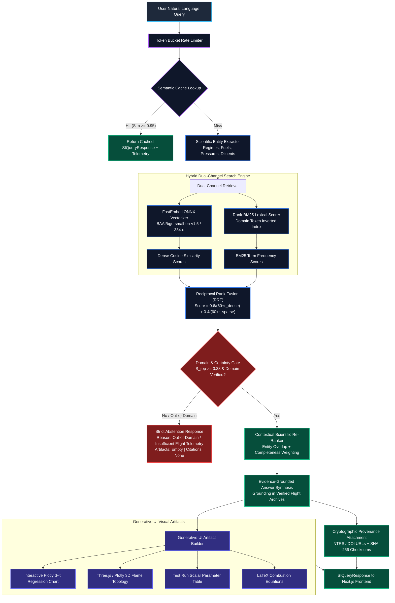
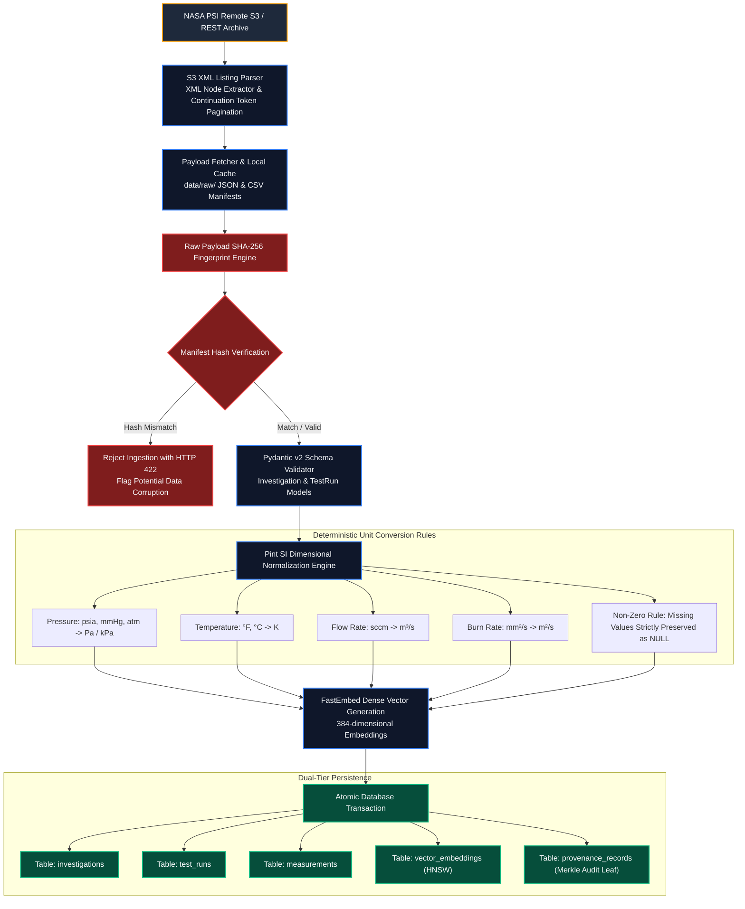
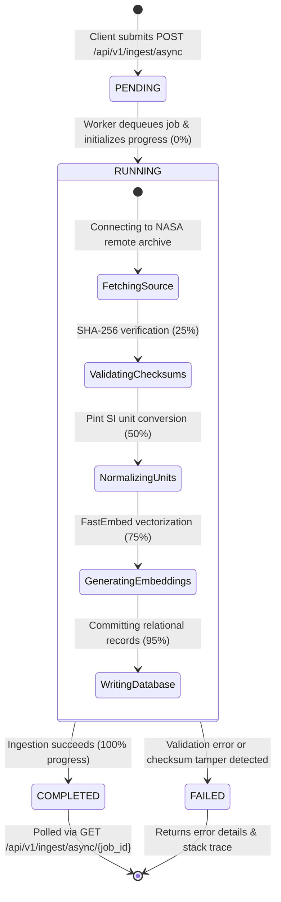

# Flame in Freefall: Project Pipeline Flow Diagrams

This document provides comprehensive, verified Mermaid flow diagrams for all primary engineering and scientific pipelines in the **Flame in Freefall** platform (CORTEXX NASA Space Apps Challenge 2026).

---

## 1. Scientific Intelligence (SI) Retrieval & Synthesis Pipeline

The SI pipeline implements a 7-stage evidence-first synthesis architecture that strictly enforces NASA source grounding and the **Zero-Fabrication Abstention Mandate**.



---

## 2. NASA PSI & NTRS Data Ingestion and Synchronization Pipeline

This pipeline governs how authentic NASA flight records from the Physical Sciences Informatics (PSI) system and NASA Technical Reports Server (NTRS) are ingested, converted, and verified.



---

## 3. Gravity Non-Equivalence & Spacecraft Fire Safety Pipeline

Analyzes multi-gravity experiments and prevents dangerous extrapolations from terrestrial 1g behavior to orbital microgravity and lunar/Martian environments.

```mermaid
flowchart TD
    classDef input fill:#1e293b,stroke:#38bdf8,stroke-width:2px,color:#f8fafc;
    classDef physics fill:#0f172a,stroke:#a855f7,stroke-width:2px,color:#f8fafc;
    classDef warn fill:#7f1d1d,stroke:#f59e0b,stroke-width:2px,color:#f8fafc;
    classDef safety fill:#064e3b,stroke:#10b981,stroke-width:2px,color:#f8fafc;

    Req[Investigation Comparison Request<br/>Investigation IDs Selection]:::input --> FetchParams[Retrieve Investigation & Test Run Parameters]:::physics
    
    FetchParams --> ClassifyRegimes[Gravity Regime Classification<br/>Microgravity 10^-6g | Lunar 0.16g | Mars 0.38g | Normal 1g | Hypergravity 2g-5g]:::physics
    
    ClassifyRegimes --> DimAnalysis[Dimensionless Number Analysis]:::physics
    
    subgraph Physics["Combustion Buoyancy & Dynamic Physics"]
        DimAnalysis --> Gr["Grashof Number: Gr = g * beta * deltaT * L³ / nu²"]:::physics
        DimAnalysis --> Fr["Froude Number: Fr = U² / (g * L)"]:::physics
        DimAnalysis --> Ri["Richardson Number: Ri = Gr / Re²"]:::physics
    end
    
    Gr & Fr & Ri --> EquivCheck{Regime Match Check<br/>Are Environments Equivalent?}:::warn
    
    EquivCheck -- Regime Delta Detected --> GenWarning[Generate AntigravityWarning<br/>Flag Terrestrial Extrapolation Invalidation<br/>Compute Buoyancy Deviation Ratio]:::warn
    EquivCheck -- Equivalent Regimes --> DirectComp[Direct Parameter Normalization]:::physics
    
    FetchParams --> CoolFlameCheck{Fuel & Diameter Check<br/>n-Heptane & d0 > 1.5mm?}:::physics
    CoolFlameCheck -- Yes --> CoolFlameModel[Cool Flame Transition Dynamics<br/>Two-Stage Quasi-Steady Burning & Low-T Kinetics]:::physics
    CoolFlameCheck -- No --> StandardCombustion[Single-Stage Classical d²-Law Model]:::physics
    
    FetchParams --> FlammabilityRules[NASA-STD-6001B Flammability Evaluator]:::safety
    
    subgraph SafetyRules["Spacecraft Fire Safety Assessment"]
        FlammabilityRules --> S1["Upward Flame Propagation Test 1"]:::safety
        FlammabilityRules --> S2["Limiting Oxygen Index (LOI) Test"]:::safety
        FlammabilityRules --> S3["Artemis Exploration Atmosphere (34% O2, 56.5 kPa)"]:::safety
    end
    
    GenWarning & DirectComp & CoolFlameModel & StandardCombustion & SafetyRules --> CompResponse[Build AntigravityCompareResponse<br/>Emit Side-by-Side Matrix + Safety Badges]:::safety
```

---

## 4. Asynchronous Background Ingestion Task Queue Pipeline

Manages non-blocking dataset ingestion jobs with resilient state tracking and real-time polling telemetry.



---

## 5. Multimodal Schlieren & Soot Pyrometry Pipeline (E-07)

Processes high-speed visual imagery from NASA flight archives, computes two-color pyrometry for flame temperatures and soot volume fractions, and enables semantic vector retrieval.

```mermaid
flowchart TD
    classDef input fill:#1e293b,stroke:#38bdf8,stroke-width:2px,color:#f8fafc;
    classDef vision fill:#0f172a,stroke:#a855f7,stroke-width:2px,color:#f8fafc;
    classDef ml fill:#0f172a,stroke:#3b82f6,stroke-width:2px,color:#f8fafc;
    classDef pyrom fill:#7f1d1d,stroke:#ef4444,stroke-width:2px,color:#f8fafc;
    classDef output fill:#064e3b,stroke:#10b981,stroke-width:2px,color:#f8fafc;

    RawVideo[NASA PSI Schlieren / Rainbow Telemetry Video]:::input --> FrameExtractor[High-Speed Frame Sampler<br/>OpenCV Dynamic Sampling]:::vision
    
    FrameExtractor --> FrameMeta[SchlierenFrame Ingestion Model<br/>Timestamp, Investigation ID, Droplet D0]:::vision
    
    FrameExtractor --> TwoColor[Two-Color Soot Pyrometry Engine<br/>Wien Approximation Dual Channel]:::pyrom
    
    subgraph Pyrometry["Optical Combustion Diagnostics"]
        TwoColor --> I1["Band 1: Green Filter λ1 = 550 nm"]:::pyrom
        TwoColor --> I2["Band 2: Red Filter λ2 = 650 nm"]:::pyrom
        I1 & I2 --> Ratio["Intensity Ratio: R = I_λ1 / I_λ2"]:::pyrom
        Ratio --> TempCalc["Flame Temp: T = c2 * (1/λ2 - 1/λ1) / (ln(R) - α*ln(λ1/λ2))"]:::pyrom
        TempCalc --> SootVol["Soot Volume Fraction: f_v ∝ -ln(τ) * λ / (K_e * L)"]:::pyrom
    end
    
    FrameMeta --> FastEmbedImage[FastEmbed Multimodal Embedding<br/>Dense Feature Vectorizer 384-d]:::ml
    
    FastEmbedImage & SootVol --> SQLiteVec[Multimodal Metadata & Embedding Store]:::output
    
    SearchQuery[User Visual / Text Query<br/>'Thermal boundary layer in microgravity']:::input --> QueryVector[Dense Query Vectorization]:::ml
    
    QueryVector & SQLiteVec --> CosineRank[Cosine Similarity Search Engine<br/>Top-K Ranked Diagnostic Frames]:::output
    
    CosineRank & TempCalc --> DiagUI[Next.js Diagnostics Workspace (/diagnostics)<br/>Side-by-Side Schlieren & Thermal Map]:::output
```

---

## 6. Active Learning Bayesian Optimal Experiment Design Pipeline (E-08)

Optimizes sparse microgravity experimental campaigns by pairing an ARD Gaussian Process surrogate with an Upper Confidence Bound acquisition function across 4D parameter space.

```mermaid
flowchart TD
    classDef input fill:#1e293b,stroke:#38bdf8,stroke-width:2px,color:#f8fafc;
    classDef surrogate fill:#0f172a,stroke:#3b82f6,stroke-width:2px,color:#f8fafc;
    classDef opt fill:#7f1d1d,stroke:#ef4444,stroke-width:2px,color:#f8fafc;
    classDef proposal fill:#064e3b,stroke:#10b981,stroke-width:2px,color:#f8fafc;

    HistData[NASA PSI Historical Flight Trials<br/>Droplets: FLEX, BASS, ACME]:::input --> PreProc[4D Parameter Normalizer<br/>P, X_O2, V_vent, d0]:::surrogate
    
    PreProc --> GPFit[Gaussian Process ARD Regressor<br/>Matérn 5/2 Covariance Kernel]:::surrogate
    
    GPFit --> GPSurrogate["Fitted GP Surrogate Model<br/>Predictive Mean μ(x) & Uncertainty σ(x)"]:::surrogate
    
    GridGen[4D Candidate Space Generator<br/>Stratified Hypercube Sampling]:::opt --> UCBScore[Upper Confidence Bound Evaluator<br/>α_UCB(x) = μ(x) + κ * σ(x)]:::opt
    
    GPSurrogate --> UCBScore
    
    UCBScore --> InfoGain[Shannon Information Gain Estimator<br/>Expected Variance Reduction ΔH(y|x)]:::opt
    
    InfoGain --> CandidateRank[Top-5 Proposal Ranker & Pareto Filter]:::proposal
    
    subgraph FlightFeasibility["Flight Facility Constraint Filters"]
        CandidateRank --> F1["ISS CIR MDCA: d0 in [1.5, 5.0] mm"]
        CandidateRank --> F2["Pressure Vessel: P in [40, 300] kPa"]
        CandidateRank --> F3["O2 Safety Envelope: X_O2 in [15%, 40%]"]
        CandidateRank --> F4["Chamber Forced Flow: V_vent in [0, 20] cm/s"]
    end
    
    F1 & F2 & F3 & F4 --> ValidatedProposals[OED Candidate Proposals<br/>Rank, Physical Rationale, Info Gain]:::proposal
    
    ValidatedProposals --> OptimizerUI[Next.js OED Optimizer (/optimizer)<br/>Interactive Acquisition Landscape & Preset Loader]:::proposal
```

---

## 7. Artemis Exploration Atmosphere Fire Hazard Index Pipeline (E-10)

Quantifies spacecraft cabin fire hazards under hypoxic exploration atmospheres ($34\%\text{ O}_2, 56.5\text{ kPa}$), modeling microgravity convective boundary layer thickening ($\delta \propto v_{vent}^{-1/2}$).

```mermaid
flowchart TD
    classDef input fill:#1e293b,stroke:#38bdf8,stroke-width:2px,color:#f8fafc;
    classDef subindex fill:#0f172a,stroke:#3b82f6,stroke-width:2px,color:#f8fafc;
    classDef agg fill:#7f1d1d,stroke:#ef4444,stroke-width:2px,color:#f8fafc;
    classDef output fill:#064e3b,stroke:#10b981,stroke-width:2px,color:#f8fafc;

    AtmoParams[Atmospheric & Cabin Environment<br/>Pressure P, Oxygen X_O2, Gravity g, Flow V_vent]:::input --> SubIndices[EAFHI Sub-Index Computer]:::subindex
    
    subgraph SubIndexComputations["Physical Risk Modeling"]
        SubIndices --> S_O2["Oxygen Risk: I_O2 = (X_O2 / 0.21)^1.85<br/>Elevated Flammability Exponent"]:::subindex
        SubIndices --> S_P["Pressure Factor: I_P = (P / 101.3)^0.65<br/>Density & Reaction Quenching Scaling"]:::subindex
        SubIndices --> S_V["Microgravity Ventilation Stagnation<br/>δ_conv ∝ V_vent^-0.5 & Stagnant Pool Fire Risk"]:::subindex
        SubIndices --> S_G["Gravity Regime Buoyancy Factor: I_g<br/>Suppressed Plume vs Terrestrial 1g"]:::subindex
    end
    
    S_O2 & S_P & S_V & S_G --> Aggregator[Non-Linear Weighted Aggregator<br/>EAFHI = clamp(Σ w_i * I_i, 0.0, 1.0)]:::agg
    
    Aggregator --> ThresholdGate{EAFHI Hazard Score Evaluation}:::agg
    
    ThresholdGate -- "EAFHI < 0.35" --> LowRisk["Nominal Safe Regime<br/>Green Badge: NASA-STD-6001B Compliant"]:::output
    ThresholdGate -- "0.35 <= EAFHI < 0.65" --> ModRisk["Moderate Caution Regime<br/>Amber Badge: Secondary Extinguishers Required"]:::output
    ThresholdGate -- "EAFHI >= 0.65" --> HighRisk["High / Critical Flammability Alert<br/>Red Badge: Invalidation of Terrestrial Flammability Data"]:::output
    
    LowRisk & ModRisk & HighRisk --> FireSafetyUI[Next.js Fire Safety Suite (/fire-safety)<br/>Radar Risk Profile & Atmosphere Presets]:::output
```

---

## 8. End-to-End System Architecture & Data Flow

High-level architecture showing communication flows across all tiers of the platform, including all 13 Next.js routes and backend services.

```mermaid
graph TB
    classDef client fill:#0f172a,stroke:#38bdf8,stroke-width:2px,color:#f8fafc;
    classDef api fill:#1e293b,stroke:#a855f7,stroke-width:2px,color:#f8fafc;
    classDef svc fill:#0f172a,stroke:#3b82f6,stroke-width:2px,color:#f8fafc;
    classDef data fill:#064e3b,stroke:#10b981,stroke-width:2px,color:#f8fafc;

    subgraph Tier1["Frontend Tier (Next.js 15 App Router - 13 Routes)"]
        UI_Dash["Dashboard (/)"]:::client
        UI_Expl["Investigation Explorer (/investigations)"]:::client
        UI_Det["Investigation Detail (/investigations/[id])"]:::client
        UI_Diag["Diagnostics Workspace (/diagnostics)"]:::client
        UI_Opt["OED Optimizer (/optimizer)"]:::client
        UI_Safe["Fire Safety (/fire-safety)"]:::client
        UI_Comp["Comparison Workspace (/compare)"]:::client
        UI_SI["SI Evidence Chat (/intelligence)"]:::client
        UI_Anti["Antigravity Suite (/antigravity)"]:::client
        UI_Ana["Analytics Engine (/analytics)"]:::client
        UI_Hand["Offline Handbook (/handbook)"]:::client
        UI_404["Error Boundary (/_not-found)"]:::client
        UI_PWA["Offline PWA Service Worker"]:::client
    end

    subgraph Tier2["API & Gateway Tier (FastAPI Python 3.12)"]
        Router["Modular v1 API Router"]:::api
        RateLimiter["Token-Bucket Rate Limiter"]:::api
        Auth["NASA Launchpad SSO Guard"]:::api
        Telemetry["OpenTelemetry & Prometheus Exporter"]:::api
    end

    subgraph Tier3["Scientific Services Tier"]
        S_SI["SIService (Hybrid RRF & Abstention)"]:::svc
        S_Ingest["IngestionService & PSISyncClient"]:::svc
        S_Anti["AntigravityService (Buoyancy & Regimes)"]:::svc
        S_Queue["AsyncQueueManager (Background Jobs)"]:::svc
        S_Vision["FlameVisionProcessor (Contour & Sphericity)"]:::svc
        S_Multi["MultimodalRAGService & Wien Pyrometry"]:::svc
        S_OED["BayesianOEDService & GP ARD Regressor"]:::svc
        S_EAFHI["EAFHISafetyEngine & NASA-STD-6001B"]:::svc
    end

    subgraph Tier4["Persistence Tier"]
        DB_PG[("PostgreSQL 16 + pgvector (Production)")]:::data
        DB_Lite[("SQLite + NumPy Cosine (Dev & CI)")]:::data
        Lake[("Local File Lake: data/raw/ & data/processed/")]:::data
    end

    Tier1 -->|HTTP REST JSON & SSE Streams| Tier2
    Tier2 --> Tier3
    Tier3 --> Tier4
```


